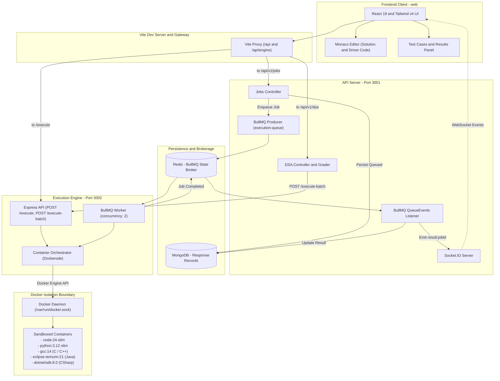
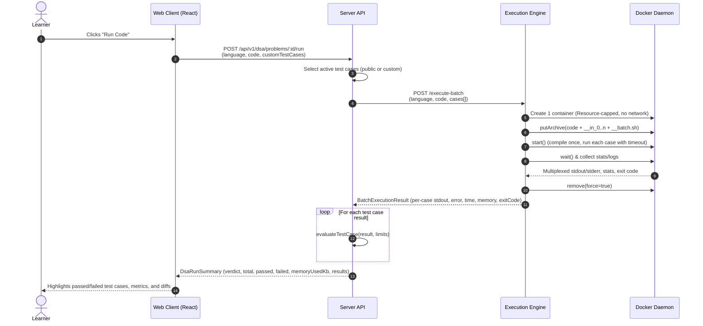
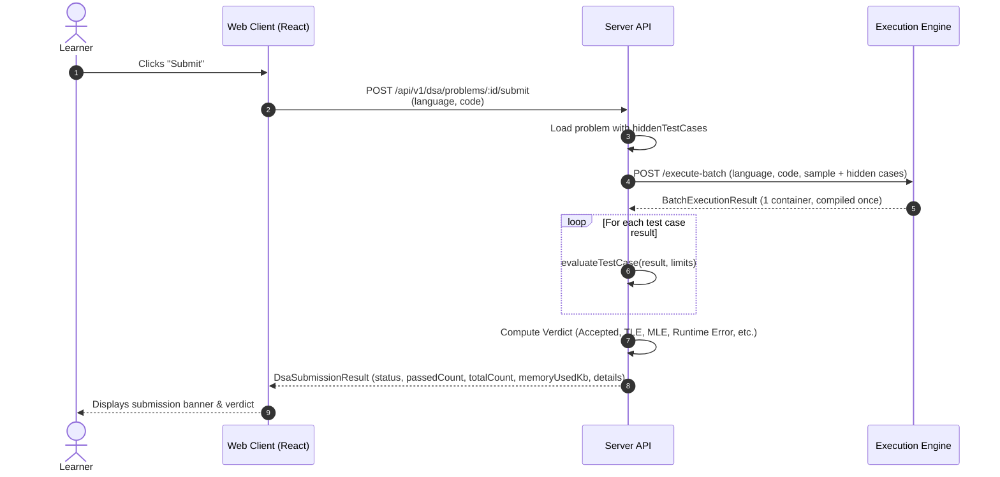
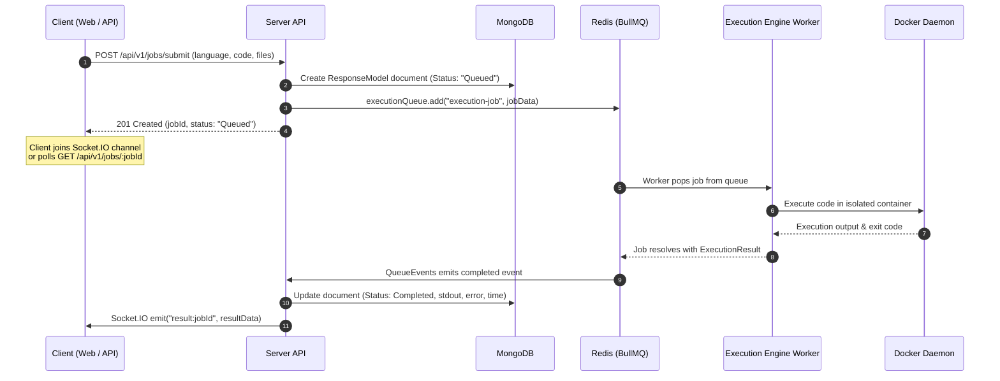

# DebugLabs: Complete Architecture & Data Flow Guide

DebugLabs is a full-stack debugging simulator and hands-on learning platform designed to help developers inspect, diagnose, and fix real bugs in codebases across multiple programming languages. It combines an in-browser IDE experience (Monaco Editor, tabbed test runner) with isolated containerized code execution and automated grading.

---

## 1. System Architecture Overview

DebugLabs is structured as an **npm monorepo** using Node.js 24 and TypeScript. The system splits concerns between the interactive client, the API orchestrator, and an isolated execution engine.



---

## 2. Monorepo Workspaces & Responsibilities

The codebase is partitioned into four npm workspaces managed by a single root `package.json`:

| Workspace | Directory | Role & Tech Stack |
| :--- | :--- | :--- |
| **`@debugLabs/shared`** | `shared/` | Shared contracts, DTOs, interfaces, supported language enums, and problem schemas. Emits compiled types to `shared/dist`. |
| **`web`** | `web/` | Single-page application built with React 19, TypeScript, Tailwind CSS v4, Monaco Editor, and Xterm.js. |
| **`server`** | `server/` | API orchestrator on port `3001` (Express 5, Mongoose, BullMQ producer, Socket.IO). Grades test cases and coordinates async jobs. |
| **`execution-engine`** | `execution-engine/` | Secure execution runtime on port `3002` (Express 5, Dockerode, BullMQ worker). Spins up ephemeral Docker containers. |

---

## 3. Workspaces Deep Dive

### 3.1 Shared Contracts (`@debugLabs/shared`)
Located in `shared/index.ts`:
- **Language Definitions**: Supports `javascript`, `python`, `java`, `cpp`, `c`, `csharp`.
- **Payload Models**: `ExecutionPayload` (source code, files array, entrypoint, stdin, optional command) and `BatchExecutionPayload` (code/files + `cases` array for single-container batch runs).
- **Execution Output**: `ExecutionResult` (status, stdout, error/stderr, executionTime, memoryUsed, exitCode) and `BatchExecutionResult` (optional `compileError` + per-case `BatchExecutionCaseResult[]`).
- **Problem & Grading Interfaces**: `DsaProblem`, `DsaTestCase`, `DsaTestCaseResult` (with per-case `verdict` and `memoryUsedKb`), `DsaRunSummary` (with peak `memoryUsedKb`), `DsaSubmissionResult`.

---

### 3.2 Frontend Client (`web`)
- **Authentication**: `web/src/context/AuthContext.tsx` restores the session from
  the backend on page load. Login/signup routes launch provider OAuth, and the
  main labs interface is protected until the server confirms the session.
- **Problem Catalog & Filtering**: `web/src/components/dsa/DsaDashboard.tsx` allows users to filter problems by difficulty (`Easy`, `Medium`, `Hard`), category (`Arrays & Hashing`, `Dynamic Programming`, etc.), or keyword search.
- **IDE Layout**: `web/src/App.tsx` and `web/src/components/common/LabShell.tsx` manage a multi-pane layout:
  - **Left Panel**: Problem statement, constraints, examples, hints, and bug descriptions (`DsaProblemTab.tsx`).
  - **Center Panel**: Monaco code editor (`CodeEditor.tsx`) configured with the `debuglabs-graphite` theme.
  - **Bottom Panel**: Tabbed interface (`OutputTerminal.tsx`) with two views:
    - *Test Cases*: View public test cases, modify inputs, or add custom test cases.
    - *Test Results*: Displays status/verdict badges, execution times, peak memory usage (`memoryUsedKb`), diffs between actual and expected outputs, and runtime errors.
- **Client Execution Strategies** in `web/src/services/executionService.ts`:
  - `executeDirect`: Direct POST to the execution engine.
  - `executeQueue`: Submits to `/api/v1/jobs/submit` and polls or waits for completion.
  - `executeInWebSandbox`: Fallback client-side evaluator using `new Function()` for offline or instant browser testing.

---

### 3.3 Backend API Server (`server`)
Located in `server/src/index.ts`:
- **Authentication**: Google and GitHub OAuth use Passport strategies in
  `server/src/auth/passport.ts`. User identities are stored in MongoDB, and
  `express-session` persists authenticated sessions through MongoDB using the
  same `MONGODB_URI` as the existing database connection. Auth endpoints are
  mounted at `/api/v1/auth`; OAuth callbacks redirect to the frontend's
  `/auth/callback` route. Provider credentials and session secrets remain
  server-side environment variables.
- **Problem Management**: Problems are loaded from `server/src/challenges/dsa/problems/index.ts`. Hidden test cases are stripped via `getDsaProblemForClient` before sending problem definitions to the frontend.
- **Grader Engine**: In `server/src/controllers/dsa.controller.ts` and `server/src/challenges/dsa/harness.ts`:
  - Sends all test cases in a single `POST /execute-batch` request.
  - Normalizes carriage returns and trims whitespace.
  - Compares container stdout with expected output, checks `exitCode === 0`, and evaluates time/memory limits.
  - Computes verdicts: `Accepted`, `Wrong Answer`, `Time Limit Exceeded`, `Memory Limit Exceeded`, `Compilation Error`, `Runtime Error`, `Internal Error`, plus peak `memoryUsedKb`.
- **Database & Queue**:
  - MongoDB tracks execution state in `ResponseModel` (`server/src/models/response.model.ts`).
  - BullMQ (`executionQueue`) pushes jobs into Redis.
  - `QueueEvents` listens for job resolution and broadcasts results over Socket.IO.

---

### 3.4 Execution Engine (`execution-engine`)
Located in `execution-engine/src/execution.ts`:
- **Dockerode Interface**: Manages container lifecycles over Unix socket `/var/run/docker.sock`.
- **In-Memory Packaging**: Uses `tar-stream` to archive code files and inject them directly into container filesystem path `/tmp/workspace` without writing temporary files to the host disk.
- **Stream Demuxing**: Implements `demuxDockerStream` to decode Docker's multiplexed stream protocol (separating stdout from stderr via the 8-byte frame header).
- **Batch Execution (`executeBatch`)**: Packs user code, all test case inputs (`__in_0..n`), and a lightweight `__batch.sh` runner into a single ephemeral container via `executeCode`. Compiled languages (`C++`, `C`, `Java`, `C#`) compile once before looping over test cases under per-case `timeout`, avoiding repeated container boot and recompilation overhead.
- **Worker Execution**: `execution-engine/src/worker.ts` runs a BullMQ `Worker` with concurrency limit of 2, picking up queued jobs from Redis.

---

## 4. End-to-End Data Flows

### 4.1 Flow 1: Interactive DSA Test Run ("Run Code")

This flow is synchronous and optimizes for low latency when verifying public or custom test cases.



---

### 4.2 Flow 2: Official Submission ("Submit Solution")

This flow runs the code against all test cases, including hidden test cases stored on the server.



> [!NOTE]
> Hidden test cases are never transmitted to the browser in `/api/v1/dsa/problems/:id`. During submission grading, the server returns only test case counts and results without exposing the hidden test inputs.

---

### 4.3 Flow 3: Asynchronous Queued Execution (Job Queue & Socket.IO)

Used for multi-file workspace executions, long-running batch jobs, or decoupled system tasks.



---

## 5. Driver Code & Solution Template Mechanism

DebugLabs uses a LeetCode-style solution template pattern:
- The user writes code inside a clean class or function (e.g. `class Solution { twoSum(...) { ... } }`).
- Below the solution, language-specific **Driver Code** reads from `stdin`, instantiates the solution, passes parameters, and writes the formatted result to `stdout`.

```javascript
class Solution {
  twoSum(nums, target) {
    // User fixes or writes logic here
  }
}

//{ Driver Code Starts
// Initial Template for javascript
import fs from "node:fs";

function main() {
  const input = fs.readFileSync(0, "utf-8").trim().split(/\s+/);
  if (!input[0]) return;
  const n = parseInt(input[0], 10);
  const target = parseInt(input[1], 10);
  const nums = input.slice(2, 2 + n).map(Number);

  const solution = new Solution();
  const res = solution.twoSum(nums, target);
  if (Array.isArray(res) && res.length === 2) {
    console.log(`${res[0]} ${res[1]}`);
  }
}

main();
//} Driver Code Ends
```

### In-Editor Handling:
In `web/src/components/editor/CodeEditor.tsx`:
1. `splitDriverCode` detects `DRIVER_START_PATTERN` (`//{ Driver Code Starts`).
2. The user code is displayed in the primary editable Monaco editor.
3. The driver code is locked as read-only.
4. When executing or submitting, `combineCode` concatenates user edits with the driver code before transmitting it to the execution engine.

---

## 6. Security & Sandboxing Matrix

Running untrusted code safely requires multiple defense-in-depth safeguards. The execution engine enforces these boundaries on every container run:

| Constraint | Configuration | Security Threat Mitigated |
| :--- | :--- | :--- |
| **Network Isolation** | `NetworkDisabled: true` | Prevents outbound scanning, reverse shells, botnets, and SSRF attacks. |
| **Privilege Dropping** | `User: "1000:1000"` | Disallows root access inside the container; restricts privilege escalation. |
| **Memory Ceiling** | `Memory: 512MB`, `MemorySwap: 512MB` | Prevents host Out-Of-Memory (OOM) crashes and swap exhaustion. |
| **CPU Quota** | `CpuQuota: 100000` (1 core limit) | Blocks CPU starvation and denial of service across parallel runs. |
| **Process Limit** | `PidsLimit: 64` | Mitigates fork bombs (`:(){ :|:& };:`) and thread spamming. |
| **Execution Timeout** | `10,000 ms` hard deadline | Halts infinite loops via `Promise.race`, terminating container via `SIGKILL`. |
| **Path Traversal Guard** | `sanitizeRelativePath` | Normalizes all archive entry paths, preventing escape from `/tmp/workspace`. |
| **Log Output Capping** | `MAX_OUTPUT_SIZE = 1MB` | Truncates stdout/stderr buffers to prevent memory exhaustion from log floods. |
| **Guaranteed Cleanup** | `container.remove({ force: true })` in `finally` | Ensures failed, killed, or crashed containers are removed immediately. |

---

## 7. Supported Language Execution Matrix

| Language | Container Image | Compilation / Invocation Command |
| :--- | :--- | :--- |
| **JavaScript** | `node:24-slim` | `node /tmp/workspace/solution.js` |
| **Python** | `python:3.12-slim` | `python3 /tmp/workspace/solution.py` |
| **C++** | `gcc:14` | `g++ -O2 -o /tmp/out/main $(find /tmp/workspace -name '*.cpp') && /tmp/out/main` |
| **C** | `gcc:14` | `gcc -O2 -o /tmp/out/main $(find /tmp/workspace -name '*.c') && /tmp/out/main` |
| **Java** | `eclipse-temurin:21-jdk` | `javac $(find /tmp/workspace -name '*.java') -d /tmp/out && java -cp /tmp/out Main` |
| **C#** | `dotnet/sdk:8.0-alpine` | `dotnet run --project /tmp/workspace` |

---

## 8. Development & Operational Commands

Install all dependencies from the root directory using npm 11 and Node.js 24:

```bash
# Clean install across all workspaces
npm ci

# Start the complete local development environment
# Starts Server (:3001), Execution Engine (:3002), and Web (:5173) concurrently
npm run dev

# Build shared types, services, and web client
npm run build

# Run linting, strict TypeScript checks, and service smoke tests
npm run check
```
